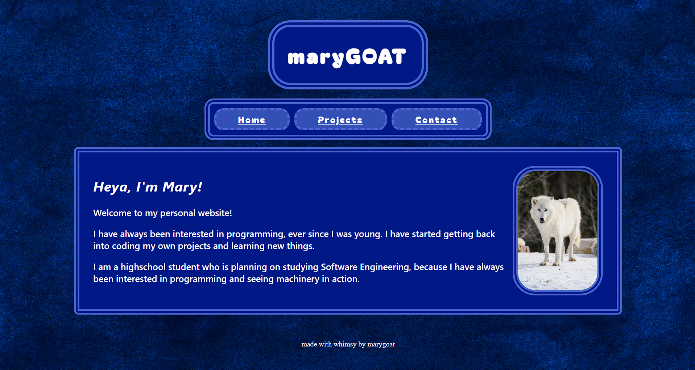

# Personal Website
Hello, and welcome to my personal website! 

## Features

Sections:
- Home: Info about me!
- Projects: Take a look at my projects! Featuring:
    - BeanPet: A virtual desktop cat for your computer!
    - TEMPO SURGE: A fast-paced game, based off WarioWare!
- Credits

## Why was this made?

I made this for the Stardance Hack Club Program, for the personal website mission! I also made this in order to remember how to use HTML, CSS, and Javascript since it has been a long time since I used them. I strive to make neater and more polished sites with more interactivity!

## AI Usage

I have used Claude to figure out why the background image wasn't appearing and for some help debugging the formatting issues. I also used ChatGPT to help me figure out why the navbar buttons didn't play a click sound.

